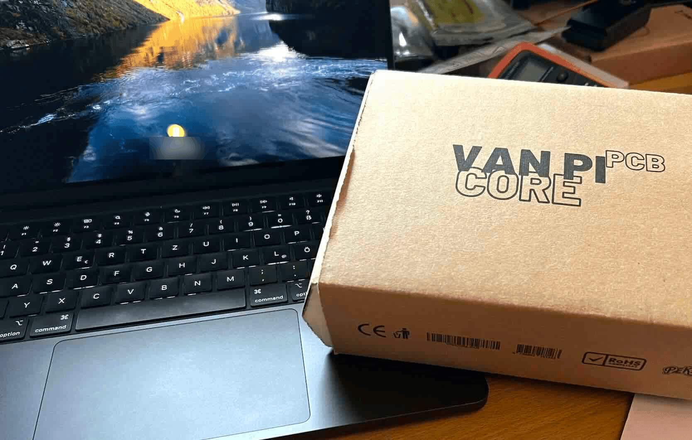

# VAN PI CORE für Home Assistant

Integration für das **[Pekaway VAN PI CORE](https://www.pekaway.de)** mit einem Raspberry Pi 4 und
Home Assistant OS. Relais, Eingänge, Tanks, Temperaturfühler, Victron-Geräte und eine Nivellierungshilfe für den Van,
komplett in der Oberfläche einzurichten.

*English: Home Assistant integration for the Pekaway VAN PI CORE board (relays, inputs, tank sensors, 1-Wire,
Victron VE.Direct, van leveling). Set up entirely in the UI. The documentation is in German; the integration
ships English and German translations.*

## Funktionen

| Funktion | Hardware auf dem Board | Ergebnis in Home Assistant |
|---|---|---|
| **Relais & Eingänge** | MCP23017 (I2C `0x20`) | 8 Schalter, 8 Binärsensoren |
| **Tanks** | ADS1115, 4 Eingänge, Pull-up je Kanalpaar umschaltbar | Füllstand (L oder %) mit eigener Kennlinie, Spannung, Widerstand |
| **Temperatur** | 1-Wire (DS18B20 u. ä.) | ein Sensor je Fühler, automatisch gefunden |
| **Victron VE.Direct** | UART4, UART5 (oder jeder andere Port) | alle Werte von MPPT und SmartShunt/BMV, Energie-Dashboard-tauglich |
| **Nivellierung** | MPU6050 auf dem Board oder beliebiger X/Y/Z-Sensor (z. B. RuuviTag) | Neigung, Blockempfehlung je Rad, optional Luftfederung, Wasserwaage und Draufsicht als Dashboard-Karten |

Jede Funktion ist ein eigener Eintrag unter dem Hauptgerät *VAN PI CORE* und kann einzeln hinzugefügt, geändert
oder entfernt werden.

## Schnellstart

1. **Home Assistant OS** mit dem Raspberry Pi Imager auf die SD-Karte schreiben.
2. **Board-Schnittstellen freischalten:** vor dem ersten Start ein paar Zeilen in die `config.txt` auf der SD-Karte
   schreiben. Kein Terminal und kein SSH nötig.
3. **Integration installieren** per HACS (benutzerdefiniertes Repository) oder manuell.
4. **Einrichten:** *Einstellungen → Geräte & Dienste → Integration hinzufügen → VAN PI CORE*, danach die
   gewünschten Funktionen hinzufügen.

## Dokumentation

| | |
|---|---|
| [Installation](docs/installation.md) | Home Assistant OS auf dem RPi 4, I2C/UART/1-Wire freischalten, Integration installieren |
| [Einrichtung](docs/einrichtung.md) | Hauptgerät, Relais, Tanks, 1-Wire, Victron, Nivellierung, eigenes Van-Bild, Fehlersuche |
| [Module im Detail](docs/module.md) | Relais, Tanks, 1-Wire, Victron: Werte und Verhalten |
| [Nivellierung](docs/nivellierung.md) | Kalibrierung, Benutzung am Stellplatz, Entitäten, Dashboard-Karten |
| [Beispiel-Dashboard](docs/beispiele/dashboard-nivellierung.yaml) | fertige Ansicht für die Nivellierung |
| [Umstieg von den alten Komponenten](docs/migration.md) | von `mcp23017`, `ads_waterlevel`, `onewire_sysbus`, `victron_*`, `mpu650` |

## Voraussetzungen

- Pekaway VAN PI CORE mit Raspberry Pi 4
- Home Assistant OS, aktuelle Version (getestet mit Home Assistant 2026.2 und neuer)
- Für die Installation per HACS: [HACS](https://hacs.xyz)

## Alte Komponenten

Bis Version 1.x bestand dieses Repository aus sechs einzelnen Komponenten mit YAML-Konfiguration. Sie liegen nur noch
zum Nachschlagen unter [`legacy/`](legacy/) und werden nicht mehr gepflegt. Wie der Umstieg geht, steht in
[docs/migration.md](docs/migration.md).

## Haftungsausschluss

Die Nutzung erfolgt auf eigenes Risiko. Für Schäden, die direkt oder indirekt durch die Verwendung entstehen, kann
keine Haftung übernommen werden. Das gilt besonders für Relais, die Verbraucher im Fahrzeug schalten.

## Mitmachen und Hilfe

- Fehler und Wünsche: [GitHub Issues](https://github.com/maxlin1/PekawayVANPICORE_homeassistant/issues).
  Bitte Home-Assistant-Version, Integrationsversion und einen Auszug aus dem Protokoll (`vanpi_core`) angeben.
- Pull Requests sind willkommen.
- Austausch: [Pekaway Forum](https://forum.pekaway.de) und
  [Home Assistant Community](https://community.home-assistant.io).

Antworten können auch mal ein paar Tage dauern.

## Danksagungen

- Der Home-Assistant-Community für Dokumentation und Beispiele.
- Pekaway für das VAN PI CORE und die Hardware-Dokumentation.
- [@MikeTsenatek](https://github.com/MikeTsenatek), ohne ihn wäre das Projekt nicht so weit gekommen.
- [@schroeder-robert](https://github.com/schroeder-robert) für den Austausch und weitere Ideen.
- [@DerKleinePunk](https://github.com/DerKleinePunk) für Ideen und Austausch.
- Die alten Komponenten bauten auf [jpcornil-git/HA-mcp23017](https://github.com/jpcornil-git/HA-mcp23017) und
  [thecode/ha-onewire-sysbus](https://github.com/thecode/ha-onewire-sysbus) auf.

Viel Spaß mit dem VAN PI CORE in Home Assistant! Wenn ihr spannende Projekte umsetzt, teilt sie gern im Forum
oder per Pull Request.

## Lizenz

MIT, siehe [LICENSE](LICENSE).
